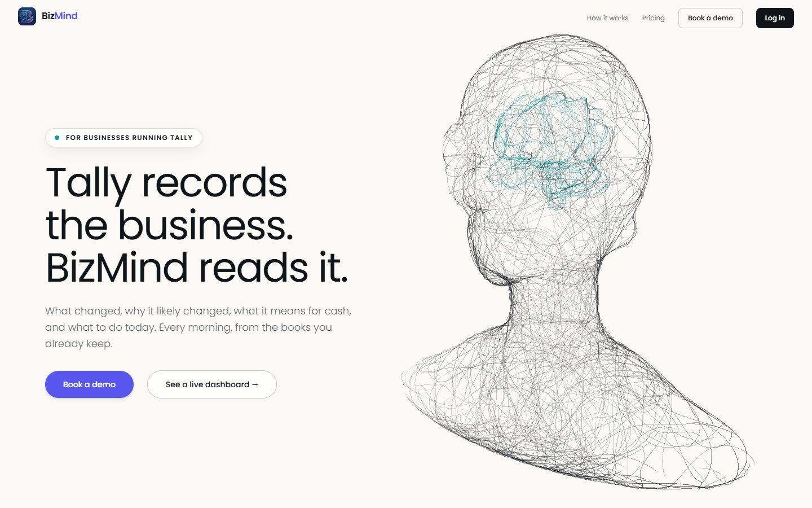
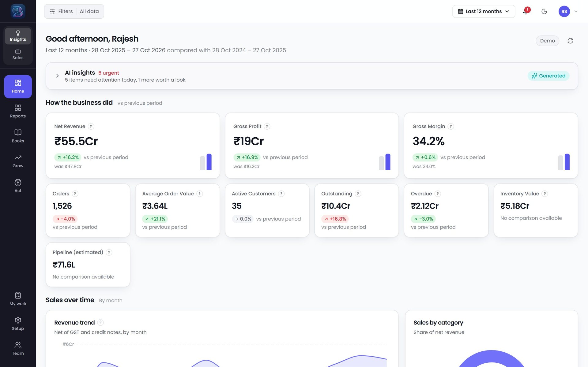
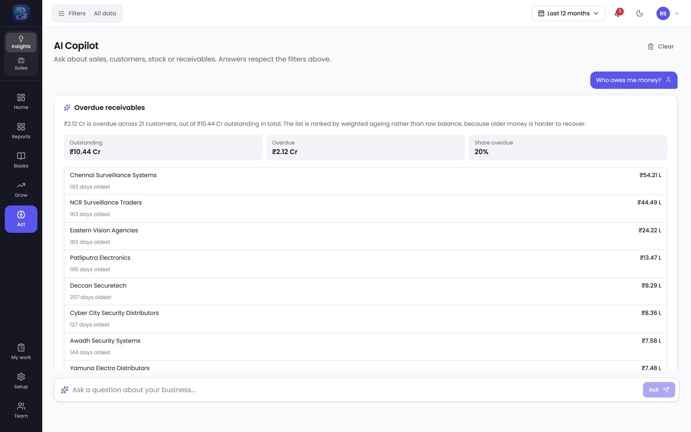
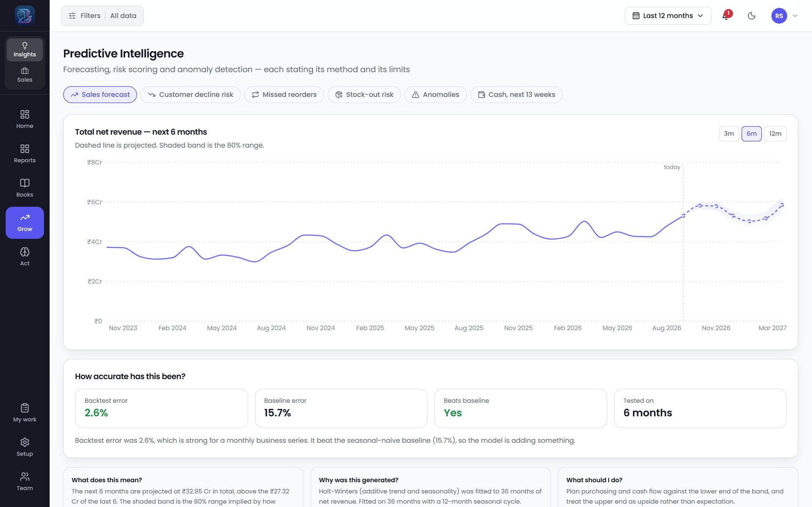
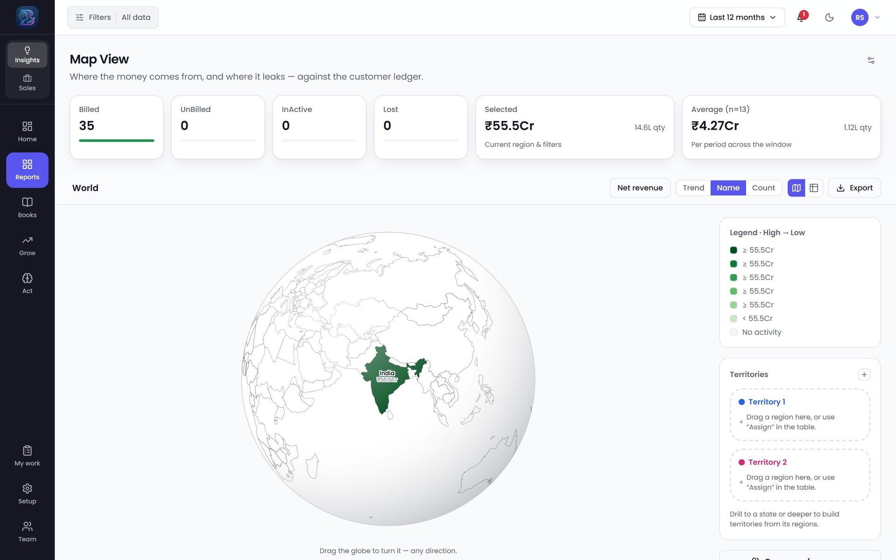
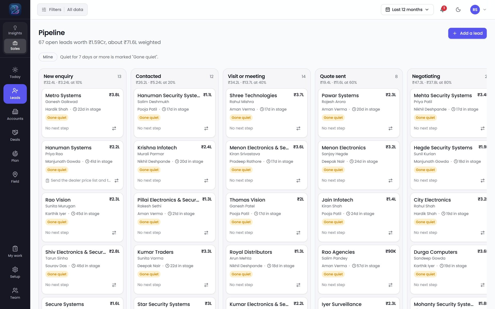
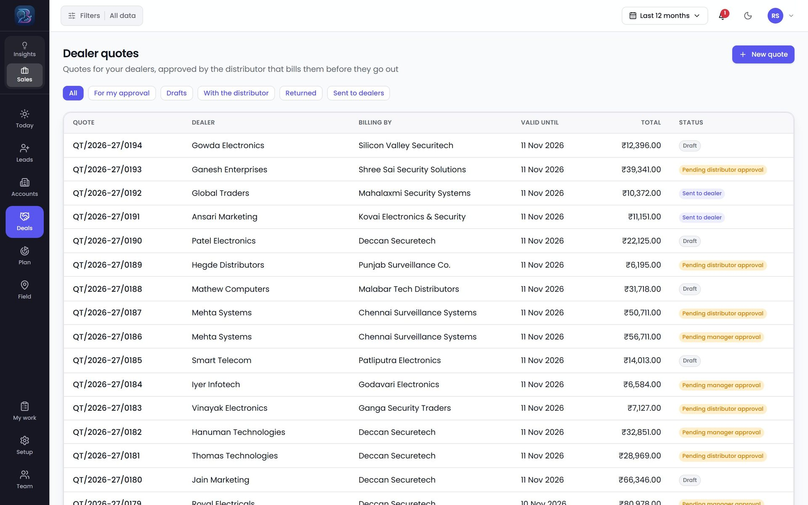
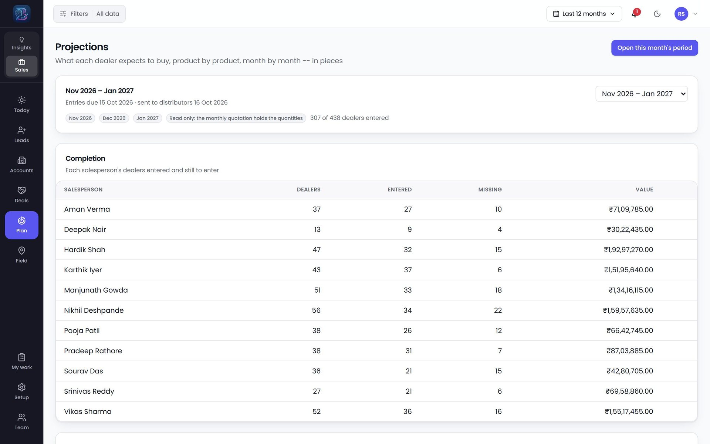
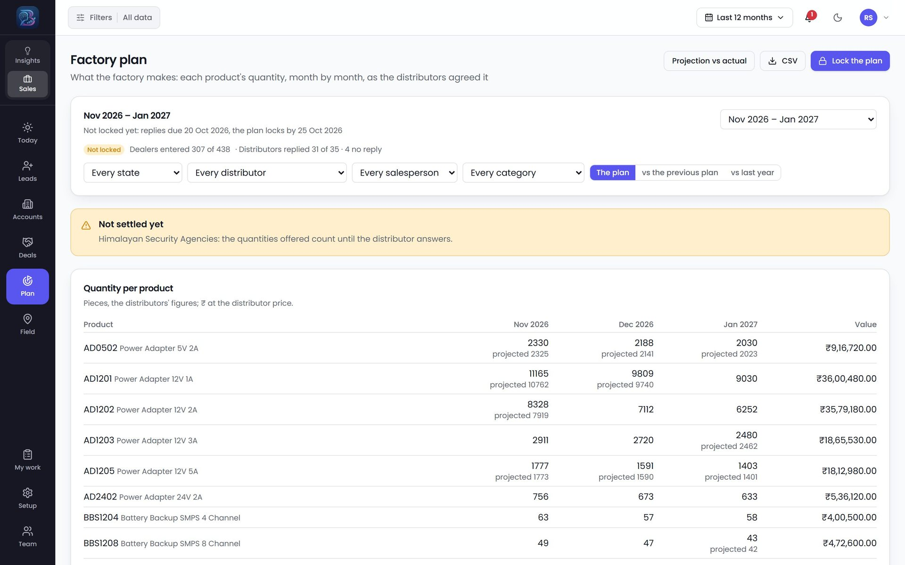
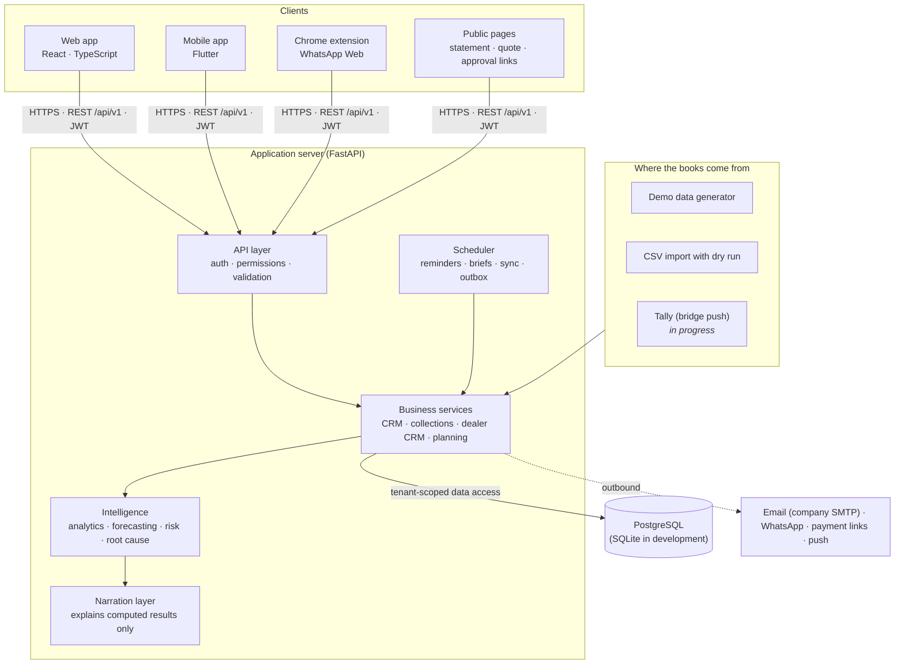

# BizzMind

### Business decision intelligence and CRM for Indian SMEs

*Tally records the business. BizzMind reads it: what changed, why it likely changed, what it means for cash, and what to do today.*

**[Overview](#overview)** · **[Problem](#the-problem)** · **[Features](#features)** · **[Screenshots](#screenshots)** · **[Architecture](#architecture)** · **[Tech stack](#tech-stack)** · **[My contributions](#my-contributions)** · **[Roadmap](#roadmap)**

> [!IMPORTANT]
> **This is a showcase repository.** It contains documentation, diagrams and
> screenshots only. BizzMind's source code is proprietary and lives in a private
> repository. See the [copyright notice](#copyright-notice).

  

---

## Overview

**BizzMind** (shown in the product as *BizMind*) is a multi-tenant SaaS platform for small and
mid-sized Indian manufacturers and distributors, most of which keep their books in **Tally**.
It reads a company's books and turns them into explained analytics, forecasts, decisions and
day-to-day sales and collections workflows.

The product has four parts that share one API:

| Client | What it is |
| --- | --- |
| **Web app** | The main product: analytics, intelligence, CRM, collections and the dealer–distributor CRM, in two workspaces (*Insights* and *Sales*) |
| **Mobile app** | A Flutter client for Android and iOS, aimed at field salespeople; it computes nothing itself and shows what the server says |
| **WhatsApp extension** | A Chrome extension (prototype) that shows the customer's account beside a WhatsApp Web chat |
| **Public pages** | Pages a customer or distributor opens from a link, with no login: a statement with a UPI link, a quote to accept, an approval link |

BizzMind is built around a few rules:

- **Every number comes from the database.** No figure is hard-coded in the UI.
- **Every prediction states its method.** Forecasts carry their backtested error. Risk scores
  list their inputs. Root-cause output is phrased as *contributing factors*, never as proven
  causes.
- **The assistant explains numbers; it never queries data.** A question selects one of a fixed
  set of read-only analytics tools, or the assistant declines it.
- **When something isn't built, the product says so** instead of showing placeholder numbers.

## The problem

Indian SMEs run on Tally, spreadsheets and WhatsApp:

- **The books record transactions but don't explain them.** An owner can see that sales fell.
  They can't easily see which customers, products or regions caused it, whether it will
  continue, or what it means for cash in the coming weeks.
- **Collections are manual.** Someone has to work out who is overdue, send reminders,
  remember who promised to pay, and handle disputed bills, usually over personal WhatsApp.
- **Sales through distributors runs on spreadsheets.** A manufacturer that sells through
  distributors to dealers has to handle dealer quotes, distributor approvals, monthly
  projections and the factory's production plan. That happens across Excel, email and phone
  calls, with no single view.
- **Field teams have no simple daily tool**, so managers lack visibility into visits, orders
  and follow-ups.

BizzMind reads the books a company already keeps. It explains them, predicts what comes next,
and runs the sales, collections and planning workflows on top.

## Features

A summary is below. **[The full feature catalogue](docs/FEATURES.md)** lists every module, and
marks what is complete and what is still in progress.

<table>
<tr>
<td width="50%" valign="top">

**📊 Analytics & dashboards**
- KPI overview with period comparison and drill-down
- Sales, customer, inventory and finance analytics; gap analysis
- Customer 360, a single view of one account
- Dashboard suite: Day, Item, Payment, Gross-profit, Snapshot and Trend views
- **Map View**: an interactive globe drilling down to Indian states and districts, plus sales territories
- Customer movement, cohort matrix, multi-dimensional targets

</td>
<td width="50%" valign="top">

**🧠 Intelligence & decisions**
- Sales forecasting (Holt-Winters) with a seasonal-naive baseline and backtested error
- Customer-decline and stock-out risk, anomaly detection, root-cause analysis
- 13-week cash-flow view as a range, based on each customer's payment history
- Liquidity ratios with the source of every figure
- **Decision Center**, **What-if simulator**, tasks & alerts, outcome tracking
- **Ask BizMind**: plain-language questions answered from an allow-list of analytics tools

</td>
</tr>
<tr>
<td valign="top">

**💰 Collections (receivables)**
- Follow-up templates, rules and a WhatsApp queue
- Public statement page with a UPI payment link
- Customers can reply: *paid* / *will pay by* / *bill is wrong*
- Promise-to-pay tracking, dispute register, credit-control approvals
- "Did the money follow the message?" chase-effectiveness view

</td>
<td valign="top">

**🤝 CRM**
- Leads and a drag-and-drop pipeline board
- Enquiry forms (link, QR code, website)
- Quotations with GST worked out
- Sales orders that can be spoken in Hindi, Hinglish or English
- Customer records, tags, custom fields, timeline, tickets, tasks, notifications
- Automation rules, email from the company's own mail server, visit plans and check-in, meeting notes

</td>
</tr>
<tr>
<td valign="top">

**🏭 Dealer–distributor CRM**
- For manufacturers that sell only through distributors
- Dealers and distributors with KYC and GST checks; lead → dealer conversion
- Versioned price lists and a branded dealer price-list PDF
- Dealer quotes approved by the distributor through secure single-use links
- Monthly projections → distributor quotation → **planning lock** → **factory plan** → projection vs actual
- Daily visit sheets, *Today* / *Team today* / *Management* dashboards, ten reports

</td>
<td valign="top">

**🛡️ Platform & security**
- Multi-tenant: company isolation enforced in one central place on the server
- Role-based module access and row-level data scope
- Platform console, consented and expiring support access, audit log
- Login attempt limits, revocable tokens, optional two-step (TOTP) sign-in
- Consent and data rights in line with India's DPDP Act 2023
- English and Hindi interface

</td>
</tr>
</table>

## Screenshots

All screenshots use **generated demo data** for fictional companies. No real customer data is
shown. More are in the **[screenshot gallery](docs/SCREENSHOTS.md)**.

| | |
| :---: | :---: |
|  |  |
| **Overview**: KPIs against the previous period | **Ask BizMind**: questions answered from the books |
|  |  |
| **Predictive intelligence**: each method states its limits | **Map View**: where revenue comes from, region by region |
|  |  |
| **Pipeline**: weighted value per stage, quiet leads flagged | **Dealer quotes**: approved by the distributor before sending |
|  |  |
| **Projections**: each salesperson's dealers, month by month | **Factory plan**: distributors' agreed quantities, then the lock |

> 🎬 **Demo video:** *coming soon.* A walkthrough link will be added here.

## Architecture

Three design choices carry the system:

1. **A pluggable business-data source.** Analytics never read a data source directly, so
   switching from demo data to CSV or Tally doesn't change any analytics code.
2. **A narration layer that can't invent numbers.** It receives figures that have already been
   computed and authorised, and only decides how to word them.
3. **Tenant isolation in one central place.** Every query is scoped to the caller's company by
   the data layer. If the scope is missing, the request fails instead of returning another
   company's data.

**[The architecture page](docs/ARCHITECTURE.md)** goes deeper, with diagrams for the request
path, the assistant, the dealer CRM's monthly cycle and the engineering workflow.

## Tech stack

| Layer | Technologies |
| --- | --- |
| **Frontend** | React 19, TypeScript, Vite, Tailwind CSS v4, Radix UI, React Router, TanStack Query & Virtual, React Hook Form + Zod, Recharts, D3 (geo, scales), Three.js / React Three Fiber, GSAP, Framer Motion, dnd-kit |
| **Backend** | Python 3.13, FastAPI, SQLAlchemy 2.0, Alembic, Pydantic v2, PyJWT, bcrypt, `cryptography`, PyOTP, httpx |
| **Data & forecasting** | pandas, NumPy, statsmodels (Holt-Winters exponential smoothing) |
| **Documents** | fpdf2 + HarfBuzz text shaping (PDFs with Devanagari), Segno (UPI QR codes as SVG) |
| **Database** | PostgreSQL (production), SQLite (development), 70+ Alembic migrations |
| **Mobile** | Flutter / Dart, Riverpod, go_router, Dio, fl_chart, secure storage, speech-to-text, geolocator, optional Firebase Cloud Messaging |
| **Browser extension** | Chrome Manifest V3 |
| **Testing** | pytest, Vitest + Testing Library, Playwright browser smoke tests, Flutter tests |
| **Ops** | Docker, Docker Compose, nginx, health probes, scheduled backup and restore-drill scripts |

## By the numbers

<table>
<tr>
<td align="center"><b>600+</b> API endpoints</td>
<td align="center"><b>120+</b> service modules</td>
<td align="center"><b>70+</b> database migrations</td>
<td align="center"><b>58</b> design documents</td>
</tr>
<tr>
<td align="center"><b>2,400+</b> backend tests</td>
<td align="center"><b>700+</b> frontend unit tests</td>
<td align="center"><b>200+</b> browser smoke checks</td>
<td align="center"><b>280+</b> recorded design decisions</td>
</tr>
</table>

Approximate figures from the private codebase, November 2026. Test counts are from the
last full run of each suite.

## My contributions

BizzMind is built by a small team. This section covers **my own work**: about 115 of the
project's 213 commits, from August to November 2026. **[The detailed breakdown](docs/CONTRIBUTIONS.md)**
lists each area.

- **Dealer–distributor CRM (end to end).** Seventeen milestones covering:
  - channel mode and roles, distributors, dealers, price lists and PDFs
  - dealer quotes with distributor approval through secure links, and dealer orders
  - monthly projections, the distributor quotation, the planning lock and the factory plan
  - daily visit sheets, dashboards, ten reports, Hindi, and the dealer screens in the Android app
  - an end-to-end test that walks the whole story
- **AI Copilot (*Ask BizMind*).** Intent routing to an allow-list of read-only analytics tools,
  with deterministic narration and an explicit refusal path for questions it can't answer.
  Later extended to promises, disputes, collections and cash.
- **Collections suite.** Promises to pay, a dispute register, the public statement page, and
  customer replies from that page. Also collection ownership for salespeople,
  chase-effectiveness analysis, credit control and the morning brief.
- **Flutter mobile app.** The first version of the Android/iOS client (*a client that
  computes nothing*), later extended with meetings, cash and the dealer CRM.
- **Data onboarding.** A per-company data source and scheduled sync, the Tally *bridge* (the
  customer's machine pushes to the server), and CSV import with a dry-run preview.
- **Meetings and the accountant.** Meeting notes with proposed actions that a person confirms,
  pre-meeting briefs checked against the books, and Tally change-request slips that are
  verified once the books show the change.
- **Forward-looking views.** A 13-week cash view, "usually bought together" and missed-reorder
  cards.
- **Landing page.** A Three.js "thread figure" with scroll-driven animation, reduced-motion and
  no-WebGL fallbacks, and accessibility and performance checks.
- **WhatsApp Customer 360 extension** and **production readiness**: Docker, a config guard,
  health probes and deployment docs.

**How I work:** I build in milestones, each gated by automated checks (pytest, Vitest, type
checks, lint, a migration round-trip and a browser smoke test), and I record every
non-obvious decision in a numbered decision log. The larger build phases were run as
structured, milestone-by-milestone sessions with an AI coding agent (Claude Code). Each had a
written brief, a plan, quality gates and a review per milestone.

## Project status

BizzMind is in **active development** and has **not yet been deployed publicly**. These parts
are deliberately marked as unfinished:

| Area | Status |
| --- | --- |
| Web app, CRM, collections, dealer CRM, analytics, intelligence | ✅ Built and tested against generated demo data |
| Multi-tenancy, permissions, security, audit | ✅ Built and tested |
| CSV import and Tally bridge ingest | ✅ Built |
| Tally live connector | 🟡 In progress: the XML parser is waiting on a recorded capture from a real Tally |
| Mobile app (Flutter) | 🟡 Passes `flutter analyze` and its test suite; not yet built as an APK or tested on a device |
| Docker deployment | 🟡 Dockerfiles and Compose written; images not yet built and verified |
| Live LLM wording for the assistant | ⚪ Interface designed, not implemented. The assistant runs fully on deterministic logic |
| Hindi translations | 🟡 Machine-drafted, awaiting native-speaker review |
| WhatsApp Business API, payment gateway, push | 🟡 Integration points exist and stay off until configured |
| WhatsApp extension | 🟡 Prototype |

## Roadmap

- **Tally live sync:** finish the parser against a real recorded capture, then run pilots on real company books
- **First deployment:** build and verify the Docker images, set up staging, add CI for all test suites, run the PostgreSQL suite in CI
- **Mobile release:** APK builds, testing on handsets, push notifications, a company and period selector, broader offline reading
- **Optional LLM wording** for the assistant, behind the existing interface, with every figure in the output checked against the input
- **Meeting capture:** a speech-to-text provider for recorded meetings (the integration point and per-company usage metering already exist)
- **WhatsApp Business API** provider, alongside the browser extension
- **Accountant (CA) console:** one view across many client companies for a chartered accountant (design written, not built)
- **Native review of the Hindi** interface, and further Indian languages

## Contact

**Aryan Raj**: [github.com/aryanraj71](https://github.com/aryanraj71)

The source code is private. I'm happy to walk through the architecture, design decisions and
code in an interview.

## Copyright notice

**© 2026 Aryan Raj. All rights reserved. This repository is provided solely for project
demonstration and portfolio purposes. No permission is granted to copy, modify, redistribute,
or commercially use the project materials.**

This repository has no open-source license. "BizzMind" and "BizMind" and the associated logo,
screenshots and documentation are proprietary. See [COPYRIGHT.md](COPYRIGHT.md).
