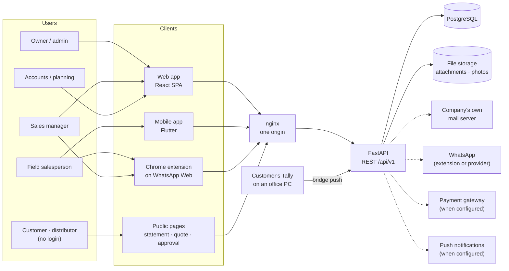
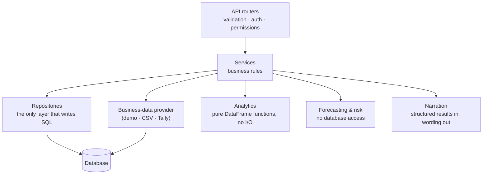
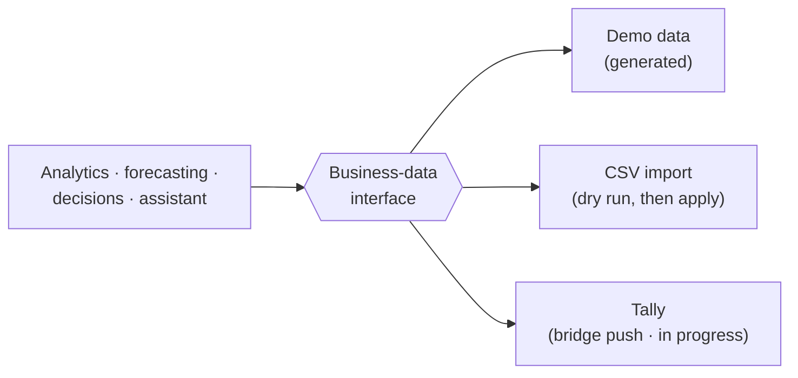
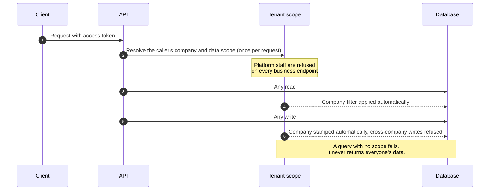
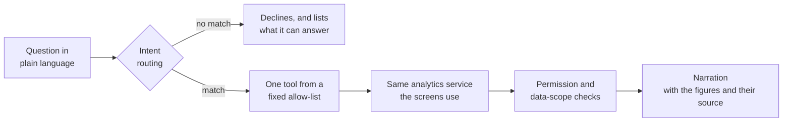
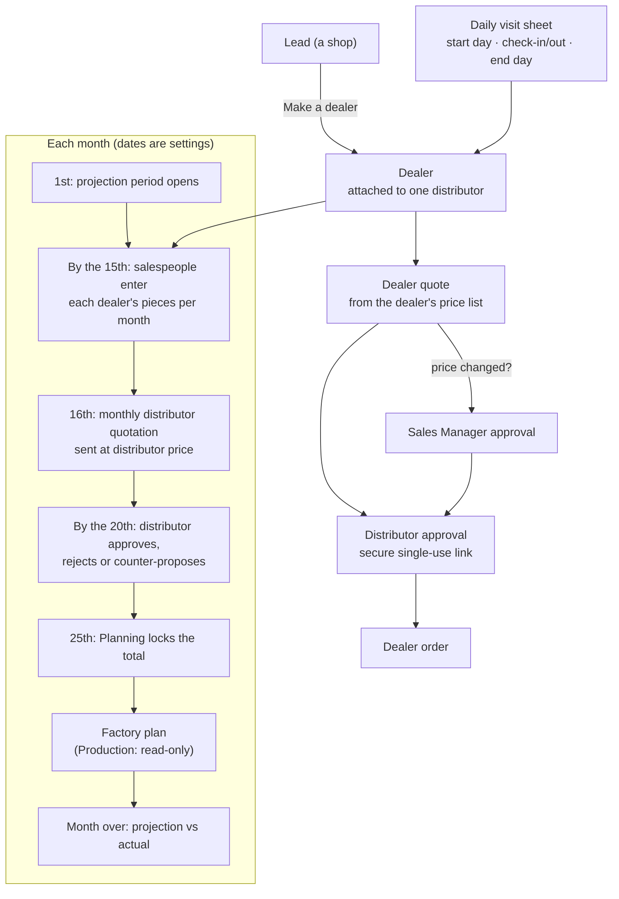
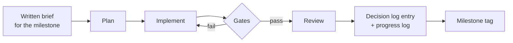

# BizzMind: architecture

[← Back to README](../README.md)

A high-level view of how BizzMind is put together and why. It shows design choices, not
implementation. No source code is included.

---

## 1. System overview

- **One API for every client.** The web app, the phone, the extension and the public pages
  all use the same versioned REST API. Business logic lives on the server, so the mobile app
  *computes nothing*.
- **One origin.** In production, nginx serves the web app and forwards `/api` to the API
  container, so the browser sees a single origin and needs no CORS setup.
- **Outbound channels stay off until configured.** Without configuration, nothing is sent,
  and the outbox records "not sent" instead of a false "sent".

## 2. Server layers

| Layer | Responsibility | Never |
| --- | --- | --- |
| API | Request/response contracts, authentication, permission checks | Build queries or hold business rules |
| Services | Business logic | Depend on the web framework |
| Repositories | Data access | Contain business rules |
| Analytics | Pure calculations on tabular data | Perform any I/O |
| Forecasting & risk | Statistical models on analytics output | Query the database |
| Narration | Turn computed results into business English | Query the database |

These boundaries are a large part of why the codebase can carry 600+ endpoints and still
change safely.

## 3. Three seams that carry the design

### 3.1 Where the books come from

All business data reaches the analytics layer through one interface with a fixed column
contract. Moving a company from demo data to CSV or Tally is a setting, not a rewrite. The
same contract tests run against every provider, so a provider that returns the wrong shape
fails loudly.

### 3.2 Narration that can't invent numbers

The narration layer only receives results that were already computed and authorised, and
decides how to word them. It has no database access and no tools of its own. Swapping the
deterministic wording for a live language model could change *the wording*, but never a
figure.

### 3.3 Tenant isolation in one central place

Isolation applies to every query, and a convention like "remember to filter by company" fails
the one time someone forgets. So the scope is attached to the database session itself and
enforced automatically on every read and write. A test enumerates every route to back this
up. The few deliberate cross-company reads (sign-in, migrations, platform screens, resolving a
public link) go through one explicitly named, searchable path.

## 4. How *Ask BizMind* answers a question

- **Free text never becomes a query.** A question selects a capability, not a statement.
- **Refusing is a feature.** A confident answer to a misheard question looks exactly like a
  correct one, so unknown questions are declined.
- **No API key needed.** Routing and wording are deterministic. A live-model provider is an
  interface for later, not a dependency.

## 5. The dealer–distributor monthly cycle

Every step is recorded in the document's history. Emails to distributors carry **hashed,
single-use, expiring action links**, so a distributor without a login can approve or reject
safely.

## 6. Background work

A built-in scheduler runs the timed jobs (follow-up rules, reminders, the morning brief,
promise settlement, quote and projection deadlines, the email outbox, Tally sync, activity
roll-up). Each job runs **per company, in that company's time zone, once**: a lease stops two
workers from running the same job. Administrators can see the jobs in the platform console.

## 7. Security principles

- Access tokens with rotating refresh tokens. Logout, password change and "sign out
  everywhere" revoke them.
- Sign-in attempt limits, a password policy, and optional TOTP two-step sign-in.
- Stored integration credentials are encrypted. Public action and ingest keys are stored
  hashed and shown once.
- Public endpoints never contain a company identifier, so writing to another company through
  them is impossible by design, not merely refused.
- Support access requires consent, expires, and is read-only.
- A production configuration guard refuses to start with unsafe defaults.

## 8. Quality & engineering workflow

Every milestone has to pass:

| Gate | What it checks |
| --- | --- |
| **pytest** (2,400+ tests) | API, services, permissions, tenant isolation, an end-to-end business story with a fake mail server and a frozen clock |
| **Vitest** (700+ tests) | Components, hooks, formatting, translation completeness |
| **TypeScript + lint** | No type errors; lint errors kept at zero |
| **Migrations** | A single head, and a full up/down round-trip from an empty database |
| **Browser smoke** (200+ checks) | Drives the real app in a browser: signs in, waits for real data, drills into charts, checks the mobile layout |
| **Flutter** | `flutter analyze` clean, Flutter tests passing |

Every non-obvious choice is written up as a numbered decision (280+ so far), which keeps the
design reviewable after the fact.

---

© 2026 Aryan Raj. All rights reserved. See [COPYRIGHT.md](../COPYRIGHT.md).
