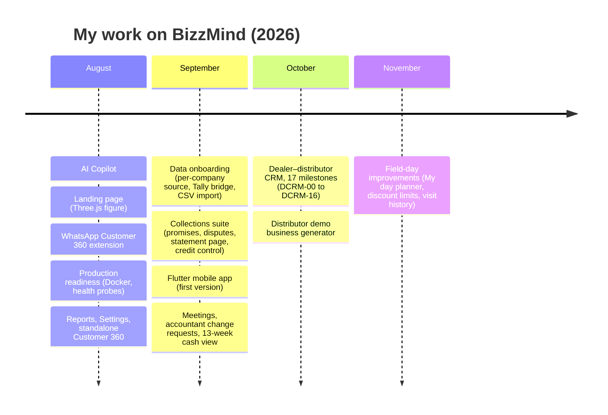

# My contributions

[← Back to README](../README.md)

BizzMind is built by a small team. This page lists **my own work**, taken from the project's
commit history: about 115 of 213 commits, August–November 2026. The project's foundation
(core data model, first dashboards, analytics and decision modules), multi-tenancy and
permissions, and the first CRM build were led by teammates. I've left those out, apart from
where I built on them.

---

## Timeline

---

## 1. Dealer–distributor CRM (October 2026)

I designed and built the whole dealer CRM as a sequence of 17 gated milestones, each with its
own branch, tests, review and decision-log entries.

| Milestone | What I built |
| --- | --- |
| DCRM-00 | Baseline: machine set-up, quality gates and a map of the codebase |
| DCRM-01 | Two workspaces (**Insights** and **Sales**) with a switch, and a **Today** page for the field |
| DCRM-02 | Per-company **channel mode**, new *Planning* and *Production* roles, every deadline as a setting, "who can do this" as rules |
| DCRM-03 | Email through the company's own mail server, editable email templates, and **secure action links** (hashed, single use, expiring) |
| DCRM-04 | **Distributors and dealers**: KYC with the GST certificate, duplicates, the state rule, dealer moves with full history, CSV import and export |
| DCRM-05 | Lead category, industry and proposed distributor, plus **Make a dealer** with history carried over and an undo |
| DCRM-06 | **Price lists** with versioning, a net-price helper, CSV, and a branded dealer price-list PDF |
| DCRM-07 | **Dealer quotes**: manager approval for changed prices, distributor approval by link, revisions, reminders, escalation, expiry |
| DCRM-08 | **Dealer orders** from visits, calls or accepted quotes, the distributor notified with the order PDF, an order register |
| DCRM-09 | **Projections**: monthly periods and each dealer's product × month grid |
| DCRM-10 | **Monthly distributor quotation** with approve, reject, comment or counter-propose by link, versions and the no-reply flag |
| DCRM-11 | **Planning lock**, approval for changes after the lock, the **factory plan**, projection vs actual |
| DCRM-12 | **Daily visit sheet**: start and end of day, visits, photos, next actions, the manager's summary, late entries, optional location |
| DCRM-13 | **Dashboards and reports**: *Today*, *Team today*, *Management* and ten dealer-CRM reports |
| DCRM-14 | **Hindi** for every dealer-CRM screen, plus the full documentation and a click-by-click demo script |
| DCRM-15 | The dealer CRM on the **Android app**: *Today*, *My day*, dealers, the order form, the projection grid |
| DCRM-16 | An **end-to-end story test** (lead → dealer → quote → distributor link → order → visit sheet → projections → monthly quotation → lock → actuals), plus a dealer-CRM browser smoke test |

Follow-up work in November added a *My day* planner for salespeople, per-team **discount
limits**, visit history, and a generator for a fictional distributor business that powers the
demo.

## 2. Collections & receivables (September 2026)

- **Promise to pay**: recorded by a person, judged by the books, and pauses chasing while it
  stands
- **Dispute register** per bill, so undisputed bills are still followed up
- **Public statement page** a customer opens from WhatsApp, with a UPI link and no login
- **Customer replies** from that page (*paid*, *will pay by*, *bill is wrong*). A claim is
  never treated as a payment
- **Collection ownership**: salespeople can chase their own accounts without seeing the whole
  company's receivables
- **Chase effectiveness**: did payments follow messages, presented as a correlation
- **Credit control**: two-person approval with reasons. The system records the decision and
  never changes a limit itself
- **Morning brief**, off by default and queued, never sent automatically

## 3. Data onboarding (September 2026)

- A per-company **data source** setting and **scheduled sync**, configured from the platform
  console
- The **Tally bridge**: when the server can't reach a customer's Tally, the customer's machine
  pushes to the server using a per-company key that is stored hashed and shown once
- **CSV import**: upload, preview exactly what would change, then apply. Includes templates,
  a reason for each rejected row, and safe re-upload

## 4. AI Copilot, *Ask BizMind* (August 2026, extended in September)

- Intent routing from plain language to an **allow-list** of read-only analytics tools, with
  parameter extraction (dimension, limit, period, account name)
- Deterministic narration that carries its figures and their source. Works with no API key
- An explicit **refusal path** for questions it can't place
- Later extended with promises, disputes, collections against target, accountant change
  requests and the 13-week cash view

## 5. Mobile app (September–October 2026)

- The first version of the **Flutter** app for Android and iOS, designed so the phone
  computes nothing: every figure comes from the API, and the menu follows what the server
  allows
- Meeting notes, the brief, credit decisions, the accountant and cash on the phone
- The dealer CRM on the phone (DCRM-15), in English and Hindi

## 6. Meetings, the accountant and forward-looking views (September 2026)

- **Meeting notes**: the product proposes actions with the quote each came from, and a person
  confirms every one
- **Pre-meeting brief** and checking statements made in a meeting against the books
- **Tally change requests**: a printable slip for the accountant, marked done only when the
  books show the change, plus speaking meeting points and sending them to the accountant
- A **transcription integration point** that never invents words, with per-company usage
  metering
- **13-week cash view** as a range, and **"usually bought together" / missed-reorder** cards
- A **master filter** that applies across every screen, responsive layouts for phone-sized
  screens, and caching performance work

## 7. Landing page, extension and production (August 2026)

- **Landing page**: a Three.js / React Three Fiber "thread figure" (a head built from a
  distance field, drawn in threads), driven by scrolling, with in-place login. Includes
  reduced-motion and no-WebGL fallbacks, accessibility checks, font-metric fallbacks and
  frame-time profiling
- **WhatsApp Customer 360 extension** (Chrome Manifest V3): the account behind the open chat,
  with a later trend view
- **Production readiness**: Docker and Compose, a production config guard, health probes,
  deployment documentation
- **Reports, Settings and standalone Customer 360**

---

## How I work

- **Milestones with gates.** Each milestone must pass pytest, Vitest, type checks, lint, a
  migration round-trip and a browser smoke test before it is merged.
- **Decisions are written down.** Every non-obvious choice becomes a numbered entry in a
  decision log, with the reasoning and the alternatives considered.
- **Honest status.** Unfinished work is labelled as unfinished, in the product and in the
  docs.
- **AI-assisted engineering.** The larger build phases ran as structured sessions with an AI
  coding agent (Claude Code). I wrote the brief, defined the milestones and gates, reviewed
  the output and owned the decisions.

---

© 2026 Aryan Raj. All rights reserved. See [COPYRIGHT.md](../COPYRIGHT.md).
