# Screenshot gallery

[← Back to README](../README.md)

Screens from the BizzMind web app running locally. **All data is generated demo data** for
fictional companies ("Demo Power Systems", a CCTV power-supply maker that sells through
distributors). No real customer, company or person is shown.

---

## Landing page

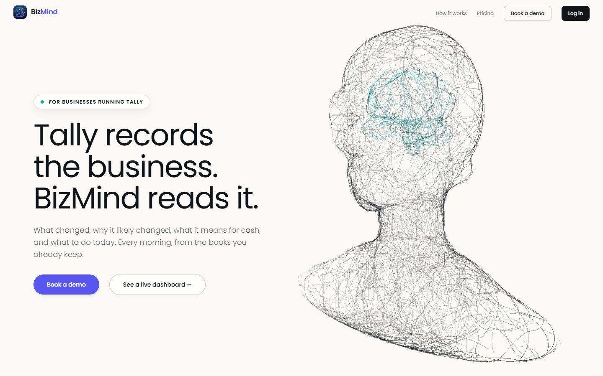

*The landing page: a Three.js head drawn in threads, with the brain highlighted, driven by scrolling.*

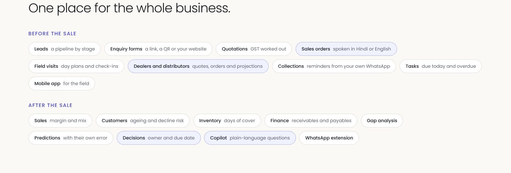

*Every module, grouped into before and after the sale.*

---

## Insights workspace

### Overview

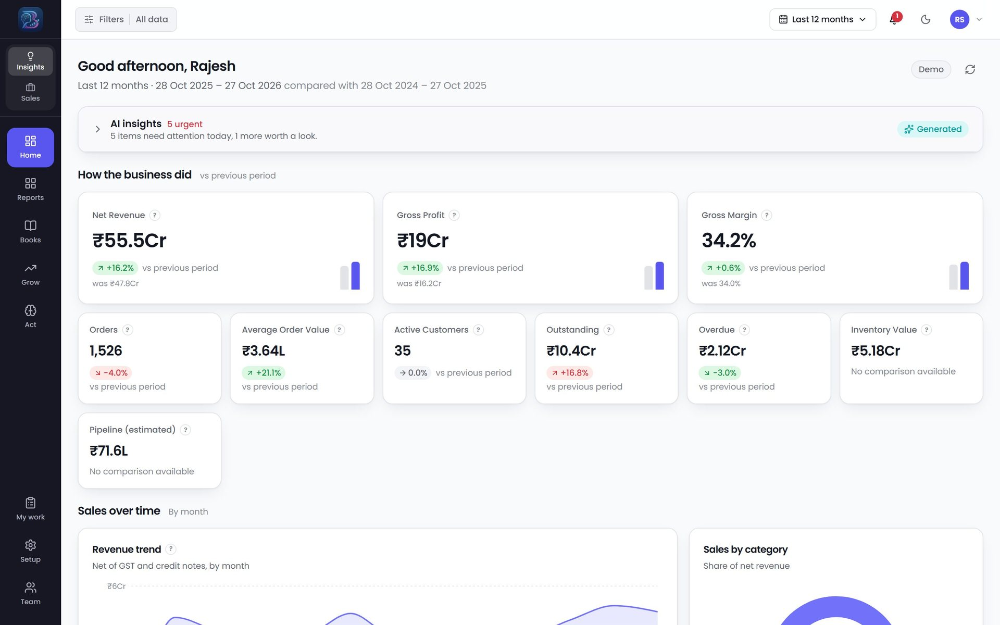

*KPIs against the previous period, each with an explanation of how it's calculated, and a
summary of AI insights that need attention.*

### Ask BizMind

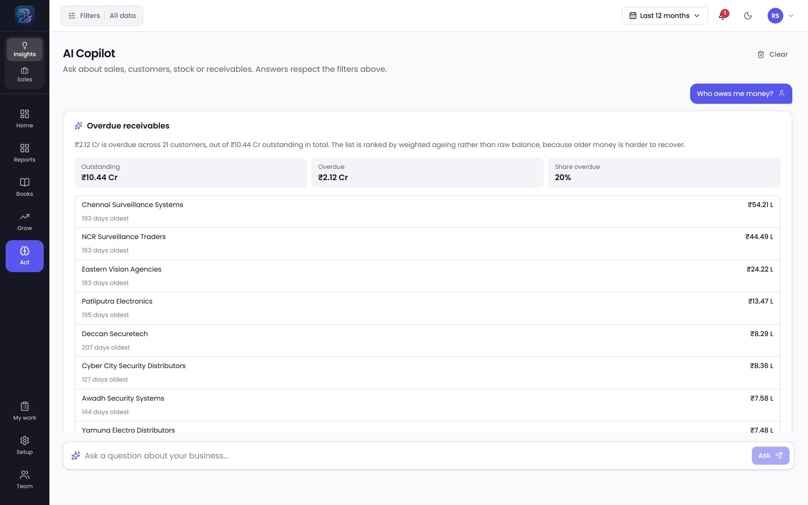

*A plain-language question answered from the books, with the figures and where they came
from.*

### Predictive intelligence

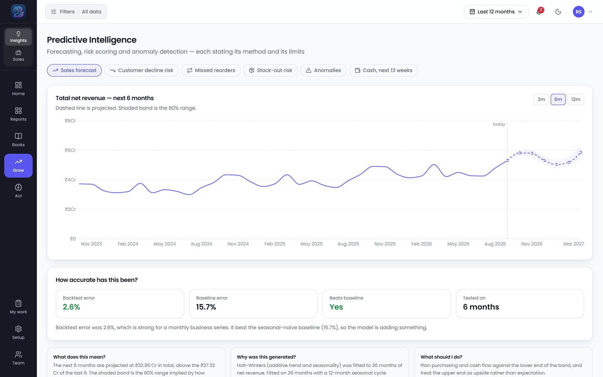

*Sales forecast, customer-decline risk, missed reorders, stock-out risk, anomalies and the
13-week cash view, each stating its method and limits.*

### Root-cause analysis

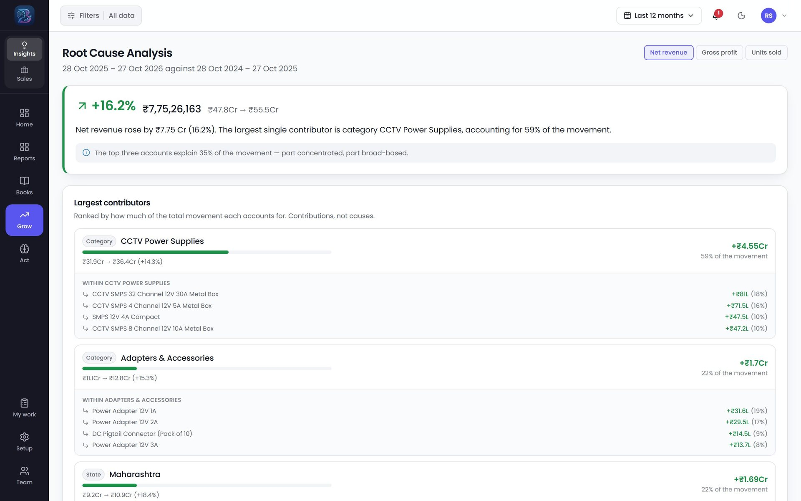

*A revenue change broken into its largest contributors by category, product and state.
Presented as contributions, not causes.*

### Decision Center

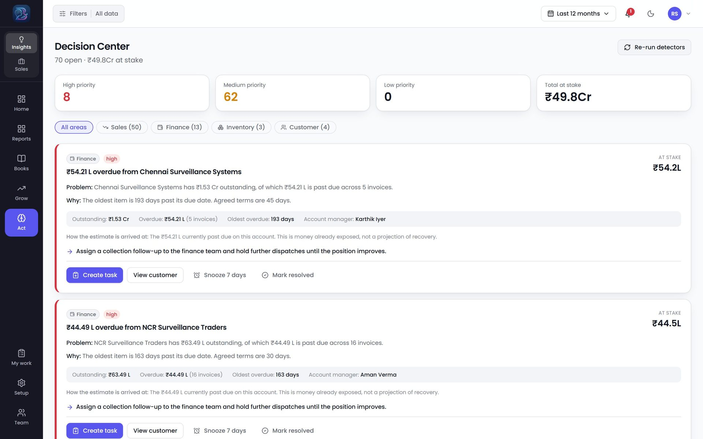

*Prioritised problems with the amount at stake, why each matters, how the estimate is
calculated, and a recommended action.*

### What-if simulator

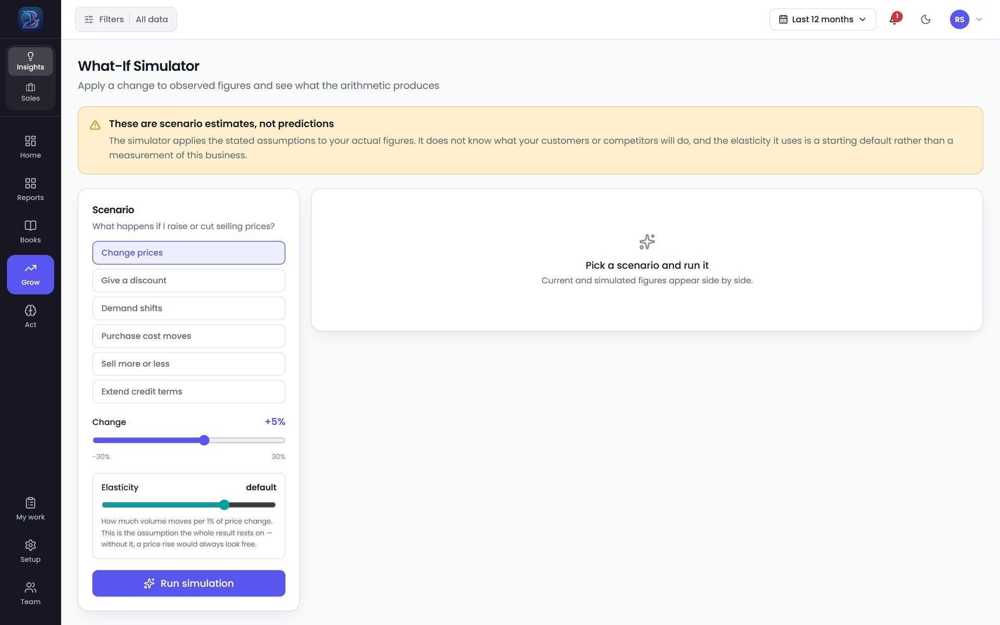

*Scenario estimates on the business's actual figures, with the key assumption (price
elasticity) visible and adjustable.*

### Map View

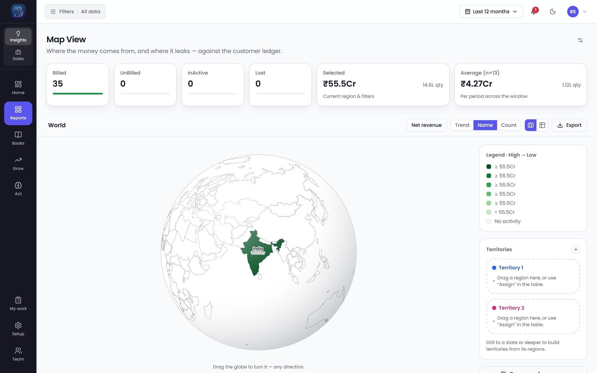

*An interactive globe that drills down to Indian states and districts, with custom sales
territories.*

### Follow-up (collections)

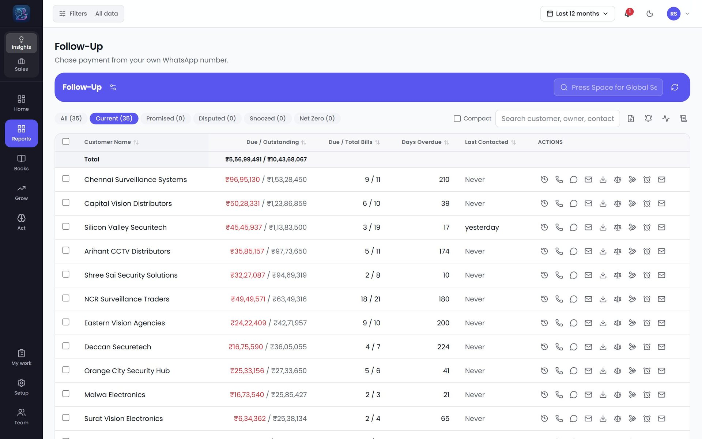

*Receivables to chase, with call, WhatsApp, email, statement, dispute, promise and snooze
actions on each account.*

---

## Sales workspace

### Pipeline

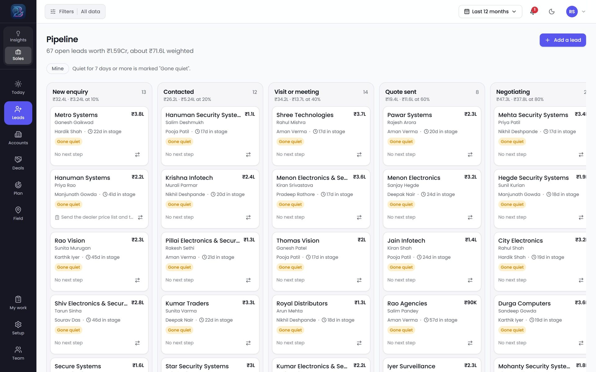

*A drag-and-drop board showing total and weighted value per stage, with quiet leads flagged.*

### Dealer quotes

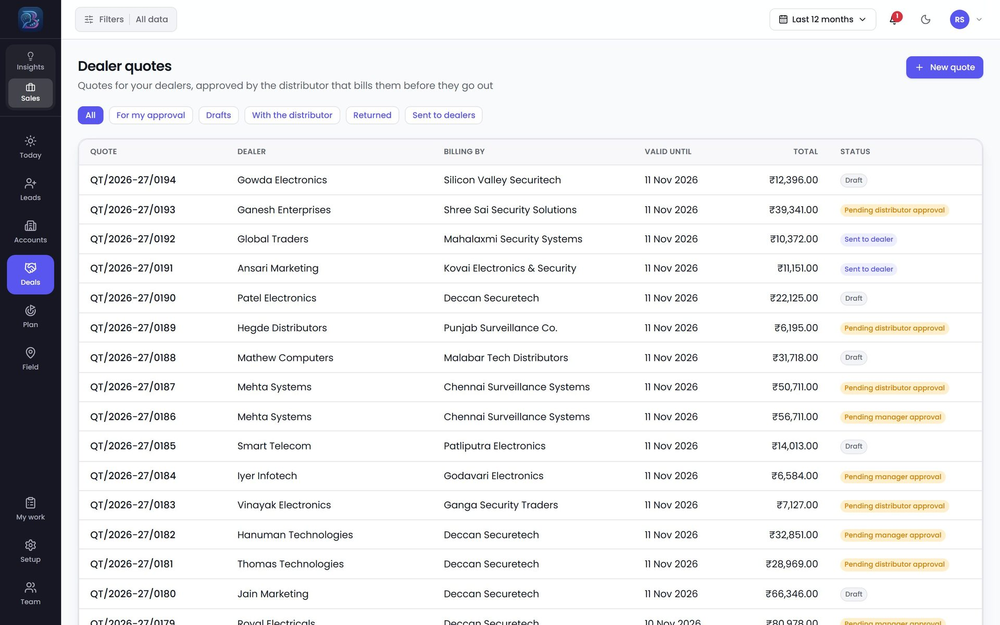

*Quotes for dealers, approved by the Sales Manager (for changed prices) and then by the
distributor before they go out.*

### Projections

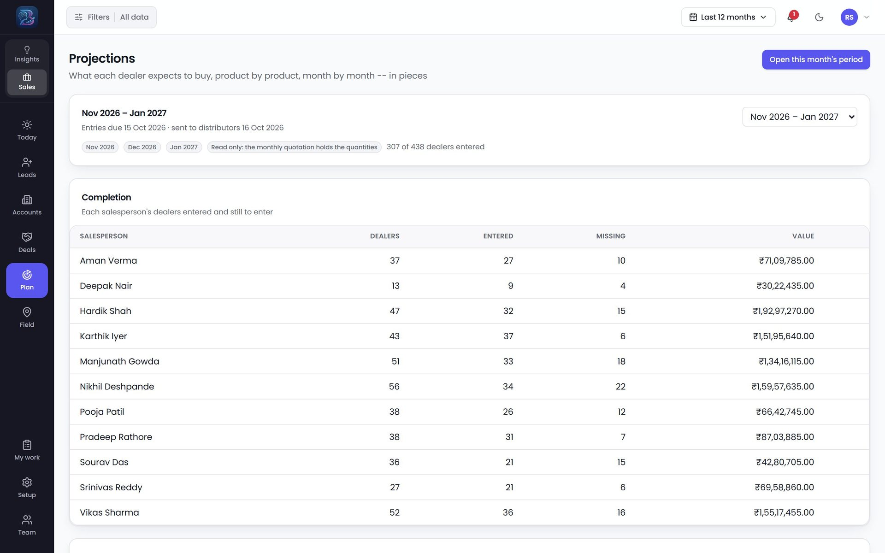

*The monthly projection period: each salesperson's dealers, entered and still missing.*

### Factory plan

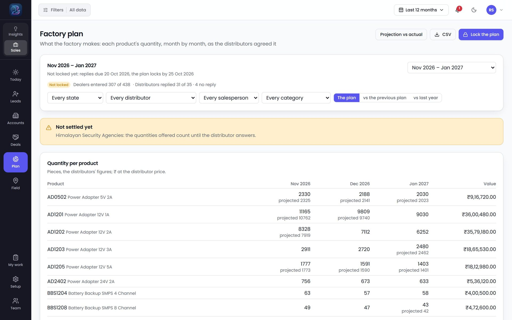

*What the factory makes, product by product and month by month, as the distributors agreed
it, before Planning locks it.*

### Management

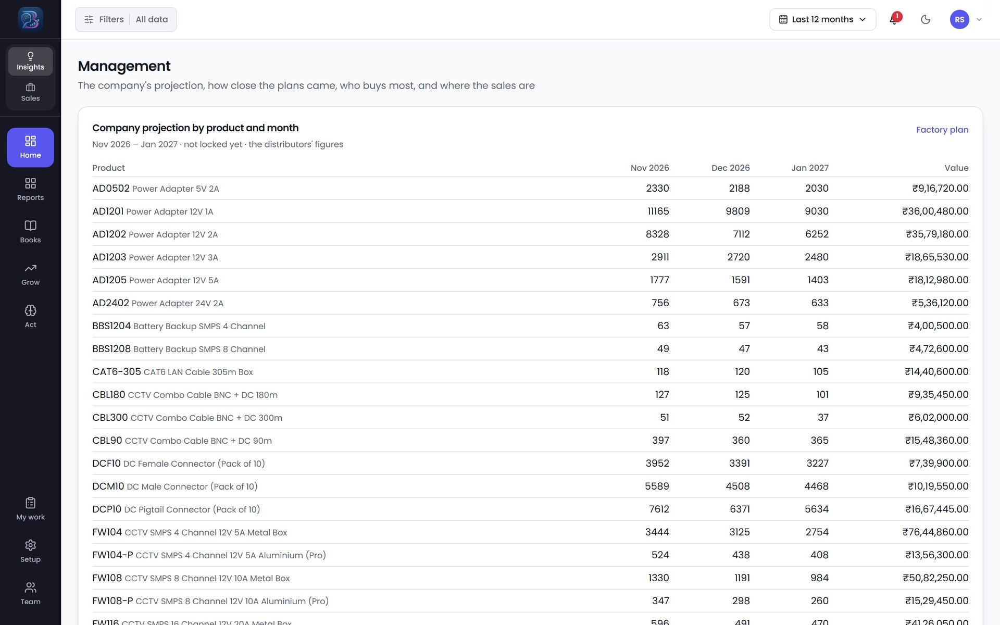

*The company projection by product and month, plan accuracy, top buyers and where sales come
from.*

---

## Dark mode

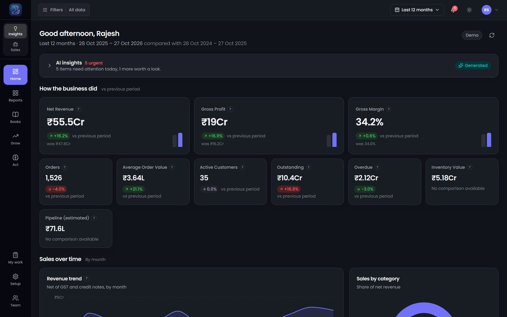

---

© 2026 Aryan Raj. All rights reserved. See [COPYRIGHT.md](../COPYRIGHT.md).
